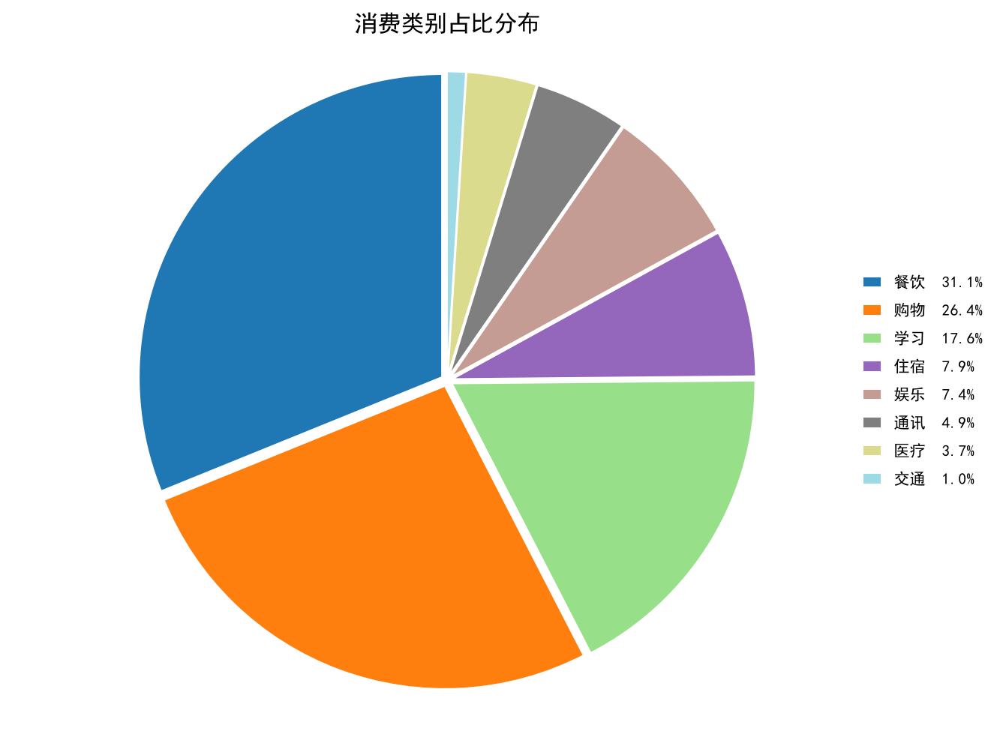
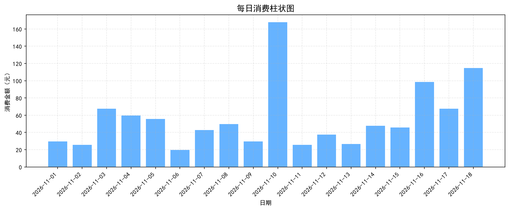
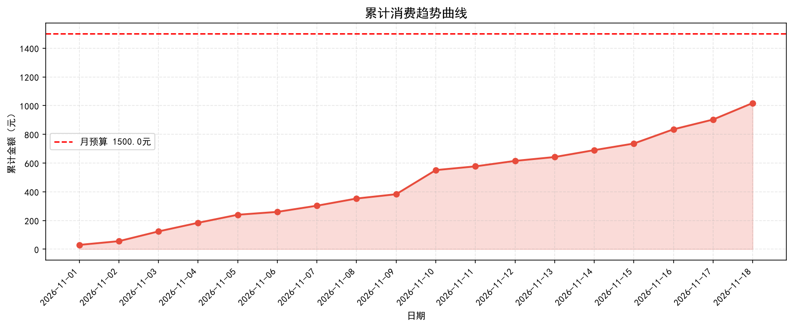
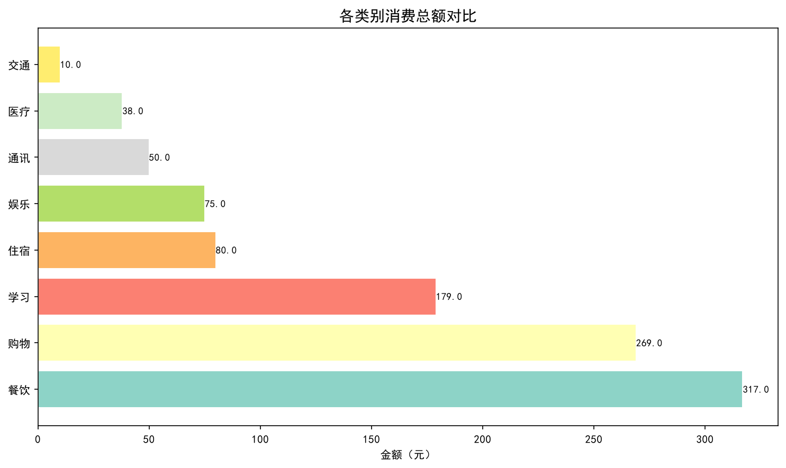

# 基于Python的大学生月度消费记账与预算预警系统

本项目是《人工智能程序设计（Python）》课程训练报告的配套源码，实现一个面向大学生月度生活费管理的命令行记账系统。程序使用 CSV 保存消费记录，使用 pandas 完成统计，使用 matplotlib 生成图表，使用 Jinja2 生成 HTML 报告。

项目仓库：<https://github.com/hhh221114/consumption-ledger>

## 1. 项目简介

系统围绕“记录—统计—预警—报告”四个环节设计，支持消费记录的增删改查、按日期和类别筛选、月度统计与环比、类别占比分析、预算执行情况核算、异常消费识别，以及 TXT/HTML 两种格式的月度报告输出。程序不依赖图形界面，绘图后端固定为 `Agg`，在无桌面环境的命令行中也能正常保存图片。

## 2. 功能特性

- 消费记录管理：新增记录、按 id 修改、按 id 删除、每页 15 条分页浏览。
- 查询与统计：按日期范围、类别筛选；月度合计、日均、分类占比、上月环比。
- 数据可视化：类别占比饼图、每日消费柱状图、累计消费趋势图、类别总额条形图。
- 预算预警：月总预算与分类预算，按使用率提示“接近预算”或“即将超支”。
- 异常检测：按 2.5 倍标准差识别异常大额消费；样本数不足 4 条或标准差过小时不判定。
- 报告输出：生成 `消费报告.txt` 和 `report.html`，HTML 报告使用 Jinja2 模板。
- 日志记录：运行过程写入 `app.log`，便于排查问题。
- 金额计算：使用 `Decimal` 处理金额，避免浮点误差。

## 3. 目录结构

```text
2025213171_韩文涛_基于Python的大学生月度消费记账与预算预警系统/
├── 消费记账系统.py              # 主程序，包含四个功能类和 main 函数
├── requirements.txt             # 第三方依赖清单
├── README.md                    # 项目说明文档（本文件）
├── readme.txt                   # 提交用纯文本说明
├── .gitignore                   # Git 忽略规则
├── my_consume.csv               # 消费记录数据
├── my_budget.txt                # 月总预算
├── cat_budget.txt               # 分类预算（JSON）
├── 报告/
│   └── 人工智能程序设计（Python）训练报告.docx
└── 运行示例/
    ├── chart_pie.png
    ├── chart_daily.png
    ├── chart_cumulative.png
    ├── chart_category.png
    ├── 消费报告.txt
    ├── report.html
    └── app.log
```

## 4. 运行环境

- 操作系统：Windows 10/11、macOS 或 Linux。
- Python 版本：3.10 及以上，开发与测试使用 3.11。
- 第三方库：pandas、numpy、matplotlib、jinja2，版本下限见 `requirements.txt`。
- 中文字体：Windows 自带黑体；其他系统如显示方框，请安装 SimHei 或在 `plt.rcParams['font.sans-serif']` 中换成已安装字体。

## 5. 安装与运行

### 5.1 Windows PowerShell

```powershell
cd 2025213171_韩文涛_基于Python的大学生月度消费记账与预算预警系统
python -m venv .venv
.\.venv\Scripts\Activate.ps1
python -m pip install --upgrade pip
python -m pip install -r requirements.txt
python 消费记账系统.py
```

如果 PowerShell 提示禁止运行脚本，先执行：

```powershell
Set-ExecutionPolicy -Scope CurrentUser RemoteSigned
```

### 5.2 macOS 或 Linux

```bash
cd 2025213171_韩文涛_基于Python的大学生月度消费记账与预算预警系统
python3 -m venv .venv
source .venv/bin/activate
python -m pip install --upgrade pip
python -m pip install -r requirements.txt
python 消费记账系统.py
```

运行后按屏幕菜单输入数字选择功能，输入 `0` 退出。退出虚拟环境使用 `deactivate`。

## 6. 数据文件说明

`my_consume.csv` 的字段为：

```text
id,日期,类别,金额,备注
```

- `id`：记录主键，整数，新增时自动分配。
- `日期`：格式为 `YYYY-MM-DD`，月份必须在 1—12。
- `类别`：餐饮、交通、学习、娱乐、购物、住宿、医疗、通讯、其他。
- `金额`：正数，单位元，不要带“元”字。
- `备注`：消费说明，可为空。

`my_budget.txt` 保存月总预算，内容为一个数字，例如 `1500`。

`cat_budget.txt` 保存分类预算，JSON 格式，键为类别、值为预算金额，例如：

```json
{"餐饮": 600, "交通": 80, "学习": 250, "娱乐": 100, "购物": 300, "住宿": 150, "医疗": 100, "通讯": 60, "其他": 50}
```

## 7. 复现步骤

1. 安装 Python 3.10 及以上版本，确认 `python --version` 与 `pip --version` 可用。
2. 进入项目目录，创建并激活虚拟环境。
3. 执行 `python -m pip install -r requirements.txt` 安装依赖。
4. 确认 `my_consume.csv`、`my_budget.txt`、`cat_budget.txt` 与主程序在同一目录。
5. 执行 `python 消费记账系统.py`，按菜单依次测试新增、修改、删除、统计、图表、预算和报告功能。
6. 程序会在项目根目录生成 `app.log`、`消费报告.txt`、`report.html` 和四张 PNG 图表；`运行示例` 文件夹保存了一次完整运行的输出，可用于核对结果。

## 8. 运行效果









## 9. Git 版本管理

项目根目录包含本地 Git 仓库，`.gitignore` 已排除虚拟环境、`__pycache__`、字节码文件和根目录下的临时输出。本地仓库包含三次提交：

1. `666f99e8` 初始提交：消费记账系统核心代码、依赖清单与忽略规则
2. `d715c88e` 加入示例数据与一次完整运行的输出结果
3. `90f678d9` 补充项目说明、readme 与课程训练报告

常用命令：

```bash
git status
git add .
git commit -m "描述本次修改"
git log --oneline
git remote add origin https://github.com/hhh221114/consumption-ledger.git
git branch -M main
git push -u origin main
```

远程仓库地址为 <https://github.com/hhh221114/consumption-ledger>。本项目已在 GitHub 创建公开仓库，并通过网页上传方式同步了源码、示例数据、运行输出和报告；由于网页上传不携带本地 `.git` 历史，远程仓库按相同阶段建立了对应的提交记录，提交哈希与本地仓库不同。本地仓库及完整提交历史随压缩包一并提交。

## 10. 常见问题

1. 图表中文显示为方框：系统缺少中文字体，安装 SimHei，或在 `plt.rcParams['font.sans-serif']` 中换成已安装字体。
2. 出现 `ModuleNotFoundError`：确认已激活虚拟环境，并执行 `python -m pip install -r requirements.txt`。
3. 图表没有弹出窗口：程序固定使用 `Agg` 后端，只保存图片文件、不弹窗，这是命令行程序的正常行为。
4. CSV 被 Excel 改坏：确保表头仍为 `id,日期,类别,金额,备注`，金额不能带“元”字。
5. 日期输入错误：程序会提示格式，必须为 `YYYY-MM-DD`，月份 1—12。
6. 修改或删除失败：先通过“查看记录”确认记录的 id，再按 id 操作；修改采用逐字段校验，任一项不合法会整体拒绝并保留原值。
